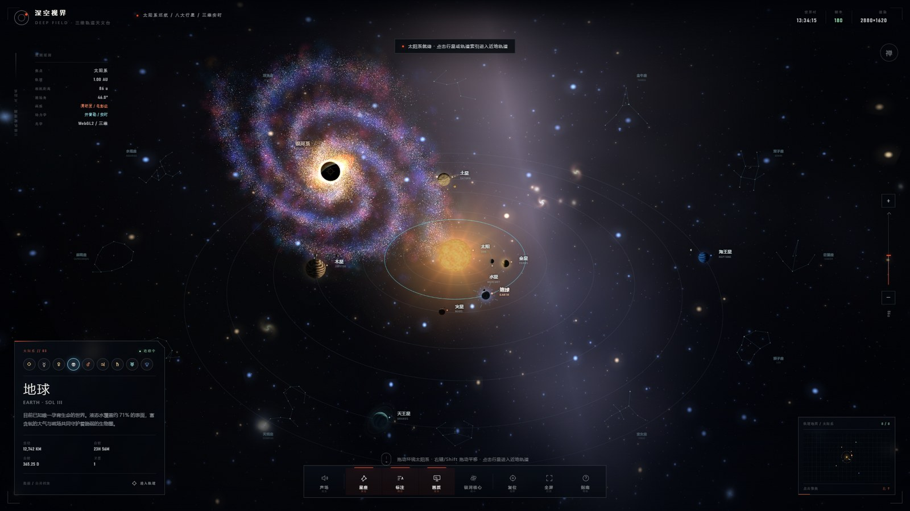
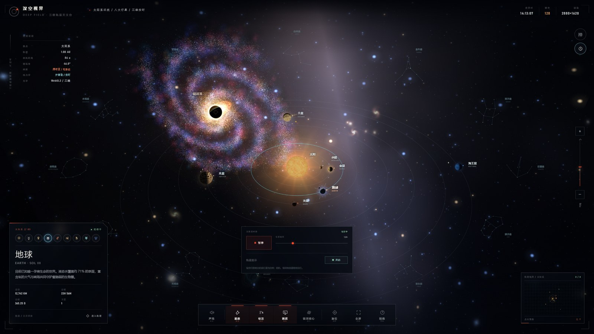
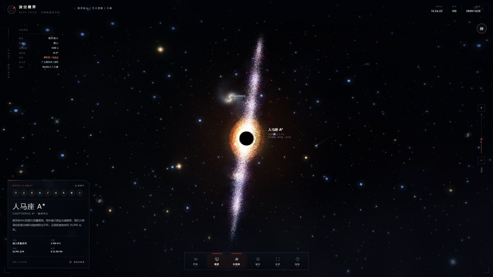
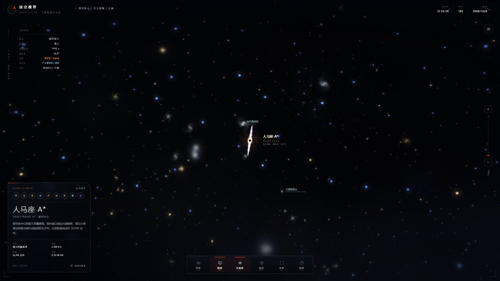
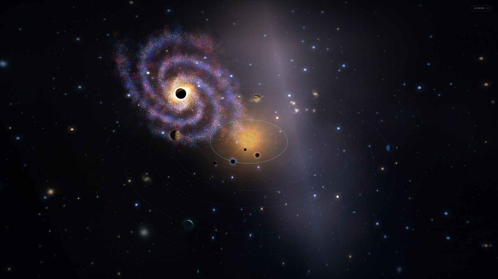
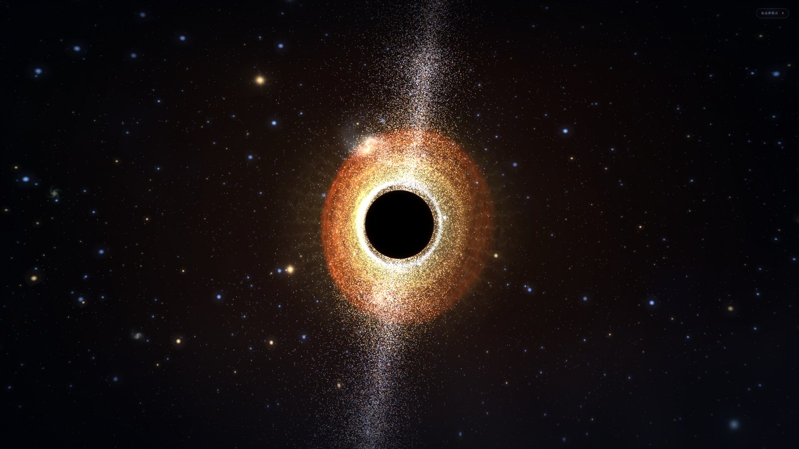
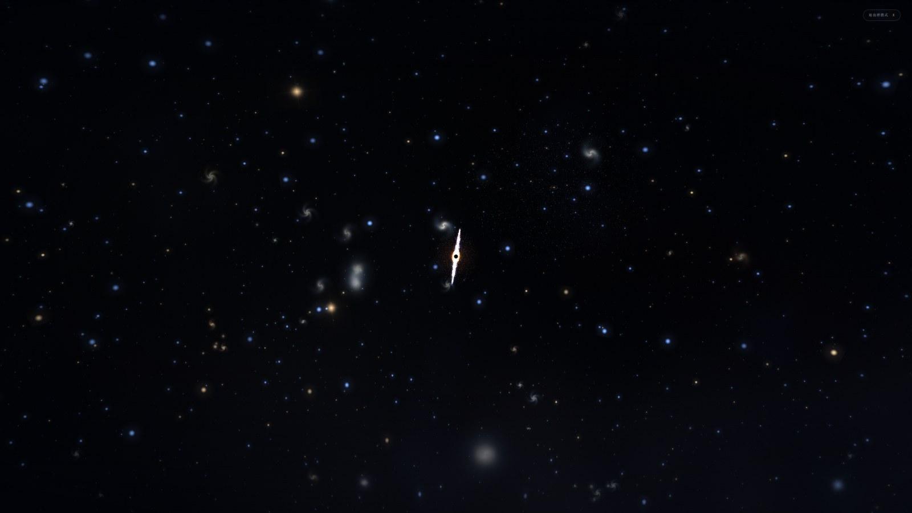

# 深空视界 · Deep Space Horizon

> 一个单文件、零依赖、可交互的 3D 太阳系与银河系观测台。
> 全部代码由 AI 在 **10 轮对话**内生成 —— 这是 vibe coding 的一次标本。

<p align="center">
  
</p>

<p align="center">
  <a href="#-运行">运行</a> ·
  <a href="#-操作">操作</a> ·
  <a href="#-技术实现">技术实现</a> ·
  <a href="#-vibe-coding-账单">Vibe Coding 账单</a> ·
  <a href="#-截图">截图</a>
</p>

---

## 这是什么

一个 **336 KB 的 `index.html`**，双击就能跑。没有构建、没有 npm、没有 CDN、没有 three.js —— 打开即是满屏星空：左侧是我们熟悉的太阳系，右上角是一整个棒旋银河，再往外是星系场，再往里是银心那颗 4.15M 倍太阳质量的超大质量黑洞。

界面上的每一个数字（轨道周期、视界阴影、距离光年、恒星数量）都写死在源码里，标着「观测目标」的卡片可以点开翻看。

它不是天文模拟器，是一件**把"宇宙"当作视觉主题做到底**的交互作品。

---

## ✨ 特性

| 特性 | 说明 |
|---|---|
| **双尺度无缝切换** | 太阳系（真实 3D 轨道）↔ 宇宙大尺度（星系场 + 银河） |
| **原生 WebGL2** | 手写渲染管线，27 段 GLSL 着色器（顶点 / 片元配对），无任何 3D 框架 |
| **程序化天体** | 行星、环系、日冕、吸积盘、光子环全部由噪声与数学生成，无贴图文件 |
| **引力透镜** | 银心黑洞按史瓦西半径做屏幕空间光线弯折，背后星光被折叠成环 |
| **生成式声场** | WebAudio 实时合成的环境音，不是音频文件 |
| **12 黄道星座** | 星图图层 + 主星标注 + 最佳观测季节 |
| **太阳系时控** | 时间倍率、暂停、轨道线开关、8 颗行星逐一点选 |
| **禅模式** | 一键隐藏所有 UI，只留画面（做壁纸 / 录屏很好用） |
| **渲染设置** | 清晰 / 自动两档模式，分辨率预设 1080p / 1440p / 2160p / 自定义 |
| **运行时可观测** | 实时 FPS、分辨率、赤经赤纬、镜头状态、小地图 |
| **状态持久化** | 音量、图层开关等写入 `localStorage` |

---

## 🚀 运行

```bash
# 方式一：直接双击 index.html
# 方式二：起个静态服务器（推荐，行为与线上一致）
python -m http.server 8080
# 然后打开 http://localhost:8080
```

**没有任何依赖需要安装。** 整个项目就是 `index.html` 一个文件。

### 在线演示

启用 GitHub Pages 后访问：

```
https://liang315325.github.io/deep-space-horizon/
```

> 开启方式：仓库 **Settings → Pages → Source 选 `Deploy from a branch` → Branch 选 `main` / `root` → Save**。
> 仓库已包含 `.nojekyll`，无需额外配置。

---

## 🎮 操作

### 键盘

| 键 | 作用 | 键 | 作用 |
|---|---|---|---|
| `V` | 进入 / 退出**银河核心** | `X` | 进入**禅模式**（`Esc` 退出） |
| `1`–`8` | 聚焦水星 → 海王星 | `9` | 聚焦太阳 |
| `T` | 太阳系时控面板 | `空格` | 暂停 / 继续公转 |
| `O` | 显示 / 隐藏轨道线 | `Z` `C` | 星座图层开关 |
| `L` | 标注图层开关 | `P` | 渲染设置面板 |
| `M` | 生成式声场开关 | `F` | 全屏 |
| `H` `?` | 观测指南 | `0` | 回到初始视野 |
| `+` `-` | 缩放 | `WASD` / 方向键 | 平移 / 转动视角 |

### 鼠标 / 触控

- **拖动**：平移（深空尺度）或转动视角（太阳系 / 银心）
- **滚轮 / 双指**：缩放，接近目标时自动切换为「靠近」状态
- **点击天体**：弹出观测卡片，含分类、质量、距离、视界等参数

---

## 🧠 技术实现

单文件不是"偷懒"，是刻意的约束 —— 它逼着所有东西都从零写。

```
index.html  7,994 行 / 336 KB
├── <style>              634 行    设计系统、面板、动画、响应式
├── <script type="x-shader"> ×27   顶点 / 片元着色器（程序化天体）
└── <script>            ~7,300 行  WebGL2 管线、状态机、交互、音频、UI
```

| 层 | 做法 |
|---|---|
| **渲染** | 原生 `canvas.getContext('webgl2')`，手写 VAO / uniform / 混合，无第三方封装 |
| **着色器** | 27 段 GLSL：噪声星云、气体行星条纹、土星环密度、日冕辉光、吸积盘多普勒、引力透镜 |
| **2D 叠加层** | 独立 canvas 负责星图、标注、坐标轴、命中测试，和 3D 层分层绘制 |
| **状态** | 单一 `state` 对象 + 显式 `syncUI()`，没有框架的数据绑定 |
| **音频** | `AudioContext` + 振荡器与滤波器实时合成，页面隐藏时自动淡出 |
| **降级** | WebGL 上下文丢失时捕获事件并提示，恢复后重载；不支持的浏览器给出可读错误页 |

**没有使用**：three.js、d3、GSAP、任何 CDN、任何构建工具、任何图片素材。
所有视觉元素不是 GLSL 算出来的，就是 CSS / SVG 画出来的。

---

## 🧾 Vibe Coding 账单

这个仓库最诚实的部分。

| 项目 | 数据 |
|---|---|
| 生成模型 | **DeepSeek V4.1 Flash** |
| 对话轮次 | **10 轮** |
| 工具 / 执行步数 | **593 步** |
| 模型累计用时 | **148 分 33 秒**（约 2 小时 29 分） |
| 总花费 | **¥10**（人民币十元） |
| 人工介入 | 需求描述 + 验收，未手写一行代码 |
| 产出行数 | 7,994 行（单文件） |

> **一个可以算的比例**：每轮对话平均 59 步、15 分钟、1 元人民币，产出约 800 行可运行的前端代码。
>
> 这不代表"AI 能替代工程师"——代价值得注意的是**验收**：着色器的参数、相机的手感、面板的密度，全靠一轮轮"不对，再调"堆出来。593 步里有多少步是在改同一个数字，源码里那些被注释掉的常量会告诉你。

### 为什么值得开源

- 它是一个**完整的反面教材**：把所有东西塞进一个文件，长期维护会很痛苦
- 它也是一个**不错的正面教材**：想做一个纯视觉 Demo 时，这种形态发布成本几乎为零
- 它证明了 **WebGL2 不需要框架也能做得很漂亮**，只要你愿意手工调 uniform

---

## 🌌 关于数据

界面里的天文参数（轨道周期、视界阴影、距离、恒星数量等）来自公开资料的**近似值**，用于视觉叙事与信息设计，**不适用于任何科研、教学考核或导航场景**。

轨道是简化的圆 / 椭圆运动，未计入摄动、轨道倾角演化与相对论效应（黑洞的引力透镜是屏幕空间的视觉近似，不是光线追踪解）。

---

## 🖼️ 截图

<table>
  <tr>
    <td width="50%"><br><sub>行星观测卡片 · 时控面板</sub></td>
    <td width="50%"><br><sub>银河核心 · 人马座 A*</sub></td>
  </tr>
  <tr>
    <td><br><sub>宇宙大尺度 · 星系场</sub></td>
    <td><br><sub>禅模式 · 隐藏全部 UI</sub></td>
  </tr>
  <tr>
    <td><br><sub>禅模式 · 黑洞与吸积盘</sub></td>
    <td><br><sub>禅模式 · 银河核心</sub></td>
  </tr>
</table>

---

## 🧩 浏览器兼容

**硬性要求**：WebGL2 + ES2020。没有 WebGL2 的浏览器会看到一段可读的错误提示，不会白屏。

| 浏览器 | 状态 |
|---|---|
| Chrome / Edge | ✅ 作者本机实测，主要开发与验证环境 |
| Firefox | ⚠️ 理论可用，**未实测** |
| Safari 15+ | ⚠️ 理论可用，**未实测** |
| 移动端浏览器 | ⚠️ 布局已做适配，但高分辨率预设大概率掉帧，未实测 |

> 说明：上面几行的「未实测」不是免责套路 —— 这个项目从生成到发布只有半天，只在一台 Windows + 独显的机器上跑过。如果你在别的浏览器上发现错位或着色器编译失败，请开 issue，附上浏览器版本与控制台报错。

建议使用独显或较新的核显。若帧率过低，打开 `P` 面板切换到「自动」模式或降低分辨率预设。

---

## ⚠️ 已知限制

在没有测试、没有工程化的情况下能跑起来，代价是这些：

- **单文件不可维护**：7,994 行里没有模块边界，改一个全局变量要全文搜索
- **没有测试**：零测试用例。渲染正确性全靠肉眼
- **状态耦合**：`state` 是单一大对象，任何一个 `syncUI()` 漏掉的分支都会留下 UI 与实际状态不一致
- **移动端没调透**：触控手势能跑，但密度和字号在小屏上偏挤
- **数据不严谨**：见上一节，所有参数都是近似值
- **AI 生成的遗留物**：源码里存在被注释掉的常量、重复的计算、命名不一致 —— 这是 593 步迭代的正常痕迹，不是 bug，但也别把它当范本学

---

## 📁 目录结构

```
deep-space-horizon/
├── index.html              # 全部代码，单文件（7,994 行）
├── screenshots/            # README 用截图（压缩版，7 张 / 876 KB）
├── LICENSE                 # MIT
├── README.md
├── .nojekyll               # GitHub Pages 跳过 Jekyll
├── .gitignore
└── .gitattributes          # 统一 LF 行尾，图片标记为 binary
```

---

## 📄 License

[MIT](LICENSE) © 2026 Liang315325

拿去改成自己的星座、换掉配色、拆成多个文件 —— 都行。

---

<p align="center"><sub>如果这个页面让你在某个加班的夜里多看了两分钟星星，那就够了。</sub></p>
